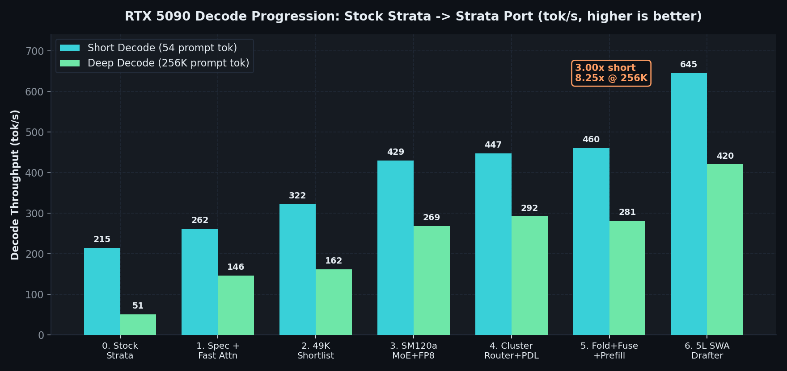
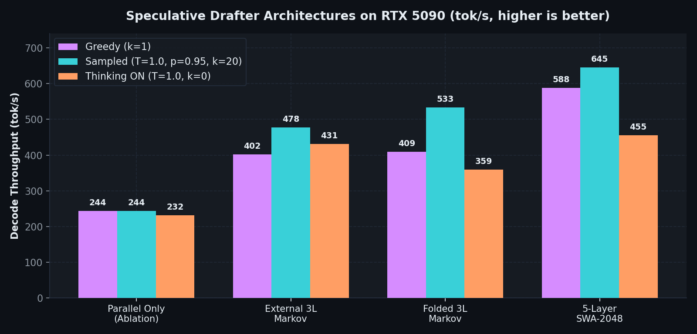
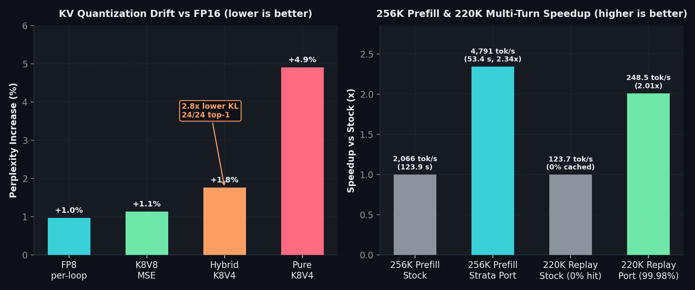

# stuff — Blackwell (`sm_120a`) Strata Port Optimization Notes

A collection of CUDA kernel, speculative decoding, KV-cache quantization, multi-turn caching, and memory optimizations built as a **Strata port** and measured on a single **NVIDIA RTX 5090 (32 GiB GDDR7, `sm_120a`, CUDA 13.3)** running a 26.4B-total / 5.4B-active looped-core MoE transformer (`24` physical layers, `3×` looped core = `48` attention/MoE visits, `128` routed experts/layer with `8` active, `20` sliding-window-1024 + `4` global attention layers, native 1M context).

---

## Headline Results (Single RTX 5090, 32 GiB All-VRAM)

| Metric | Stock Strata | Strata Port (`sm_120a`) | Gain |
|---|---:|---:|---:|
| Short decode (`54` prompt, `5×512` out, `T=1.0`) | `215.0 tok/s` | **`644.9 tok/s`** (`697.2` peak) | **`3.00×`** |
| Deep decode (`256,012` prompt, `5×512` out, `T=1.0`) | `51.0 tok/s` | **`420.3 tok/s`** (`475.9` peak) | **`8.25×`** |
| Cold `256K` prefill wall time | `123.89 s` (`2,066 tok/s`) | **`53.43 s` (`4,791 tok/s`)** | **`2.34×`** |
| Multi-turn `220K` coding replay (`5` turns) | `123.7 tok/s` (`0%` KV hit) | **`248.5 tok/s` (`99.98%` KV hit)** | **`2.01×`** |
| All-VRAM context ceiling on 32 GiB | `256K` (tight / spilled) | **`512K` (`fp8`) / `1M` (`k8v4`)** | **`2×–4×`** |
| Free VRAM after `256K` load | `< 4.0 GiB` | **`7.0–7.5 GiB`** | **`+3+ GiB`** |



---

## Step-by-Step Speedup Progression (Stock Strata → Strata Port)

Each milestone below is an end-to-end RTX 5090 measurement (`5 × 512` output tokens after warm-up, `T=1.0`, `top_p=0.95`, `top_k=20`, `256K` context ceiling):

| Stage | What Was Added | Short Decode | Short Delta | 256K Decode | 256K Delta |
|---|---|---:|---:|---:|---:|
| **0. Stock Strata** | Unmodified stock Strata release | `215.0 tok/s` | — | `51.0 tok/s` | — |
| **1. Core CUDA Spec** | Fast verify/draft attn, GPU rejection sampling, adaptive `{2,4,8}` width | `262.0 tok/s` | `+47.0` | `146.1 tok/s` | `+95.1` |
| **2. Draft Shortlist** | Per-request `32.8K` ranked + `16.4K` context draft vocab shortlist | `322.0 tok/s` | `+60.0` | `162.3 tok/s` | `+16.2` |
| **3. SM120a Core** | Tensor-Core MoE decode, 8-way FP8 dense GEMV, cluster Mix/Gates, fast E4M3 draft attn | `429.4 tok/s` | `+107.4` | `268.6 tok/s` | `+106.3` |
| **4. Cluster Router + PDL** | Single-launch 16-CTA BF16 router + SM120a PDL overlap | `446.8 tok/s` | `+17.4` | `291.9 tok/s` | `+23.3` |
| **5. Folded Markov + Epilogues** | Folded `[V,256]` Markov, fused `out_f16`/softcap, zero-copy bank swap, FlashAttn prefill (`2×`) | `460.1 tok/s` | `+13.3` | `281.1 tok/s` | `1.95× prefill` |
| **6. 5L SWA-2048 Drafter** | Native 5-layer SWA-2048 block-8 drafter (`40.3 MiB` flat KV, `72.4%` acc) | **`644.9 tok/s`** | **`+184.8`** | **`420.3 tok/s`** | **`+139.2`** |

```text
Short (54 tok)                          256K (256,012 tok)
0. Stock        ██████████░░░░░░░░░░░░  215.0  |  ██░░░░░░░░░░░░░░░░░░░░   51.0 tok/s
1. Spec+Attn    ████████████░░░░░░░░░░  262.0  |  ███████░░░░░░░░░░░░░░░  146.1 tok/s (+95.1)
2. Shortlist    ███████████████░░░░░░░  322.0  |  ████████░░░░░░░░░░░░░░  162.3 tok/s (+16.2)
3. SM120a Core  ████████████████████░░  429.4  |  █████████████░░░░░░░░░  268.6 tok/s (+106.3)
4. Router+PDL   █████████████████████░  446.8  |  ██████████████░░░░░░░░  291.9 tok/s (+23.3)
5. Fold+Fuse    ██████████████████████  460.1  |  █████████████░░░░░░░░░  281.1 tok/s (2x prefill)
6. 5L SWA-2048  ███████████████████████ 644.9  |  ████████████████████░░  420.3 tok/s (+139.2)
```

---

## 1. Speculative Decoding & Drafter Findings

### Comparing Four Drafter Architectures (Same Target, Same Hardware)

| Drafter Architecture | Greedy (`k=1`) | Sampled (`T=1, p=.95, k=20`) | Thinking (`T=1, p=1, k=0`) | Drafter KV @ 256K |
|---|---:|---:|---:|---:|
| Parallel unconditioned block-8 (ablation) | `244.0 tok/s` (`23.3%` acc) | `243.8 tok/s` (`22.7%` acc) | `231.9 tok/s` (`20.2%` acc) | `264 MiB` |
| External 3-layer Markov drafter | `402.2 tok/s` (`47.1%` acc) | `477.9 tok/s` (`52.3%` acc) | `430.6 tok/s` (`43.8%` acc) | `264 MiB` |
| Embedded 3-layer folded Markov drafter | `408.9 tok/s` (`45.2%` acc) | `533.3 tok/s` (`57.1%` acc) | `359.2 tok/s` (`33.8%` acc) | `264 MiB` |
| **5-layer SWA-2048 block-8 drafter** | **`588.5 tok/s` (`67.9%` acc)** | **`644.9 tok/s` (`72.4%` acc)** | **`455.2 tok/s` (`48.9%` acc)** | **`40.3 MiB` (0 growth)** |



### Key Speculative Decoding Techniques
- **Pure Sliding-Window Drafter KV (`SWA-2048`)**: Using a 5-layer drafter where every layer is sliding-window 2048 eliminates all global KV growth in the drafter (`40.3 MiB` fixed at `256K`, `512K`, and `1M`) while achieving `72.4%` block-8 acceptance (`+44%` short and `+54%` 256K speedup over 3-layer global-KV drafters).
- **Folded Markov Projection + Lookahead Overlap**: For 3-layer Markov drafters, precomputing the folded BF16 `[V, 256]` output projection and overlapping the 7-step `rnn_proj` pre-pass inside the lookahead backbone removes per-step projection overhead.
- **Prefix-Causal Adaptive Speculative Width (`{2, 4, 8}`)**: Instead of always verifying 8 draft tokens, compute draft logit confidence (`conf = 1 / sum(exp(logits - max))` and `minp_mass`, strictly without peeking at the sampled token so the target distribution stays 100% lossless) and pick width `{2, 4, 8}` via a 2-stage prefix-causal cost model $C(M, L) = 1 + L/L_0 + R_0(1 - (15/16)^M)$ that adapts automatically as context length $L$ grows.
- **Per-Request Dynamic Draft Shortlist**: Restricting drafter vocabulary screening to `32,834` ranked frequent/special tokens + up to `16,384` distinct prompt/continuation tokens cuts draft `lm_head` traffic by ~`4×` while the target verifier still evaluates the full `200K` vocabulary losslessly.
- **Exact 1-Launch GPU Full-Vocab Rejection Sampling (`top_k = 0`)**: Fixed full-vocabulary (`top_k=0, top_p < 1`) GPU speculative sampling with a single-launch kernel using a `1024`-slot shared-memory proposal hash table and 32-bit IEEE-754 ordinal binary search (`90/90` seeded parity cases vs CPU reference).
- **Zero-Wasted-Lookahead Speculative Scheduling**: Queueing the next drafter backbone on the GPU immediately after commit overlaps drafting with CPU token detokenization/streaming; explicit invalidation guards discard lookahead cleanly on rollbacks, stream cancellation, or history penalties.

---

## 2. Blackwell (`sm_120a`) Attention & Prefill Kernels

- **Double-Buffered `cp.async` VRAM Tree-Verify Attention**: Tiled multi-position query verification (`M = 1..8`) with register-level `cvt.rn.f16x2.e4m3x2` K widening, XOR-swizzled V shared memory, deferred scale application, relative-position bias + attention sink + ancestor masking + output gate, and `42` global splits (1 full wave across 170 SMs, `0` register spills). Hits **`1,546–1,574 GB/s`** (~90% of GDDR7 bandwidth) at `256K` (`2.67 ms` across 8 global visits vs `55+ ms` naive).
- **SM120a GQA-3 FlashAttention Prefill (`BM=64, BN=64`)**: 384-thread (`12`-warp) GQA-3 packed prefill kernel (`192` Q rows/CTA) with a branchless far-tile inner loop, inline `R @ rel_proj^T` on near tiles, algebraic attention sink + sigmoid output gate, LPT scheduling, and unified support across `FP16`, `FP8`, `K8V8`, and `K8V4`. Hits **`118–126 TFLOPS`** at `256K` with `0` register spills, cuts `256K` cold prefill from **`125.2 s` to `53.4 s` (`2.34×`)**, and eliminates `114 MiB` of prefill scratch workspace.
- **Fast Global E4M3 Draft Attention**: Applying the same double-buffered `cp.async` `kTile=32` pattern with permuted Q and XOR-swizzled V to global draft attention sped up `256K` draft attention from `546 µs` to **`339 µs` (`1.61×`, `1,548 GB/s`)**.

---

## 3. MoE Decode, Dense FP8, & Cluster Small Kernels

- **Tensor-Core MoE Decode (`mma.m16n8k16`)**: Dedicated `M = 1..8` SF4 (FP16 MMA with deferred outer scale) and MX8 (BF16 MMA with exact E8M0 scale) decode kernels featuring in-warp expert deduplication across all `M × 8` slots, fused down-projection + weighted sum + post-MLP ShortConv4 for `M=1`, and 9-warp parallel down-projection (`4` CTAs/SM, `0` spills) + `3.6 µs` reduction for `M >= 2`, saturating **`1,720–1,800 GB/s`**.
- **Programmatic Dependent Launch (PDL)**: Using SM120a `griddepcontrol.wait` / `griddepcontrol.launch_dependents` with coherent loads across the MoE decode chain overlaps `w2` and ShortConv state prefetches into the tail of preceding kernels (100% bit-exact).
- **Single-Launch 16-CTA Cluster Router & Loop Controllers**: Pre-packing MoE router weights (`13.5 MiB` BF16) and core loop controller weights (`54 MiB` BF16) enables 16-CTA cluster kernels with `st.async4` DSMEM exchange and 256-thread parallel Top-8 selection (`6.81 µs` cold-DRAM at `M=8`, `1.91×` faster, `0` expert mismatches).
- **8-Way Fused FP8 Dense Projections**: Packing all `177` dense projections (including `attn_sink_proj` and ShortConv projections) into row-scaled E4M3 (`1,059.5 MiB`) and widening multi-projection GEMV to 8 matrices eliminates 48 separate FP32 GEMV launches per pass, with only **`0.0047` nats KL** (`+0.5%` perplexity) vs native BF16.
- **Epilogue Fusions & Zero-Copy Bank Rotation**:
  - Emitting `out_f16` directly from cluster Mix/Gate kernels into MoE decode removes `48` standalone `f32_to_f16` launches per step.
  - Fusing `logit_softcap` (`30 * tanh(x / 30)`) into the final FP8 `lm_head` removes standalone conversion + softcap kernels.
  - Replacing `24` per-step device-to-device `cudaMemcpyAsync` block/bank copies with zero-copy pointer swaps (`std::swap`) eliminates unnecessary memory traffic.

---

## 4. Multi-Turn KV Checkpointing & Prefix Caching

- **Dual `prompt_ckpt` + Branched `turn_ckpt`**: Saving one checkpoint immediately before the assistant turn opener (`prompt_ckpt`) and a second checkpoint at the end-of-sampling / user-turn boundary (`turn_ckpt`, preserved across compatible prefixes) lifted real `220K` multi-turn coding sessions from **`0%` to `99.98%` KV cache reuse** (`38` new tokens prefilled per turn instead of `219,800`) and doubled decode throughput (`123.7 → 248.5 tok/s`).
- **Tree-Staged KV Quantization Roundtrip**: Quantizing and dequantizing tree-staged KV entries in the fused post-QKV kernel ensures speculative verification sees the exact same KV representation that gets committed to cache (`FP16/FP8/K8V8/K8V4`).
- **System Prefix Pinning & Image Embedding Cache**: Pinning the shared leading system/tool prefix across multi-agent requests and caching image embeddings in a 16-entry FNV-1a table avoids re-encoding unchanged system prompts and screenshots.

---

## 5. KV-Cache Quantization, Hybrid SWA/Global Storage & Memory Trimming

Measured against true **`FP16 KV + BF16 dense`** ground-truth full-vocabulary logits (`M=8`):

| KV Mode | Storage Layout | `mean_kl` (nats) | Perplexity Drift (`e^KL - 1`) | `rms_logit` | Top-1 Match | Free VRAM @ 256K |
|---|---|---:|---:|---:|---:|---:|
| **`fp8`** | E4M3 (`amax/448`), per-loop | **`0.00964`** | **`+1.0%`** | `0.4295` | `23/24` | `7,035 MiB` |
| **`k8v8`** | MSE-scaled INT8 (`s8x2→half2`), per-loop | `0.01119` | `+1.1%` | **`0.3837`** | `23/24` | `7,010 MiB` |
| **Pure `k8v4`** | INT8 K + 4-bit V everywhere | `0.04790` | `+4.9%` | `0.78+` | lower | `7,557 MiB` |
| **Hybrid `k8v4`** | **`40` SWA-1024 in `K8V8` + `8` Global in `K8V4`** | **`0.01748`** | **`+1.8%`** | `0.49` | **`24/24`** | **`7,547 MiB`** (`-512 MiB` Global KV) |



### Key KV & Memory Findings
- **Hybrid `SWA-K8V8 + Global-K8V4` (`2.8×` Lower KL)**: Keeping the `40` tiny sliding-window-1024 rings in 8-bit `K8V8` costs only `+10 MiB` total while compressing the `8` large Global caches to 4-bit V saves `512 MiB` at `256K` (`2.0 GiB` at `1M`) and cuts KL divergence by **`2.8×`** vs pure 4-bit V (`24/24` top-1 at `M=8`, `638.8 tok/s` short, `347.6 µs/visit` at `256K`).
- **Multi-Clip L2-MSE Scale Search**: Searching optimal clipping scales on `K8V8` and `K8V4` KV writes improves uniform integer quantization enough that `K8V8` beats `FP8` on `rms_logit` (`0.3837` vs `0.4295`).
- **3-Op IEEE-754 Tensor-Core Integer Dequant**: Exact 3-instruction `s8x2 → half2` and `u4x2 → half2` conversions in SM120a verify and prefill kernels hit **`1,501 GB/s`** (`K8V8`) and **`126.4 TFLOPS`** prefill with `0` register spills.
- **Unused Weight & Workspace Trimming (`+582 MiB` Free VRAM)**: Trimming unused embedded drafter weights (`357 MiB`) whenever an external drafter or `--draft off` is active and skipping unused legacy prefill buffers (`114 MiB`) freed over half a gigabyte of VRAM immediately.
- **Elastic KV Growth + WDDM-Safe Auto-Chunking**: Accounting for worst-case KV growth + `2,000 MiB` desktop/vision headroom before selecting prefill chunk size keeps `chunk=2048` up to `128K` and `chunk=1024` at `256K` with zero OS page-out, plus a clean host-tail fallback if VRAM is ever exceeded.

---

## 6. Looped-Transformer Extended Context & Contrastive Decoding Audit

- **Shared Core Loop KV (`--kv-last-loop`, `-50%` KV Memory)**:
  - Sharing the looped core's KV cache across passes (`20` SWA + `4` Global caches instead of `40` + `8`) while keeping all `48` per-pass `ShortConv4` states separate cuts KV VRAM in half.
  - **Unlocks `512K` all-VRAM** with `fp8` (`7,265 MiB` free after load, `575.0 tok/s` short, `3/3` live probes) and **`1M` (`1,048,576`) all-VRAM** on 32 GiB when combined with `SWA-2048` drafting + Hybrid `k8v4` (`6.13 GiB` Global KV at `1M`) + native BF16 dense (`-1.03 GiB` side-copy, `~2 GiB` headroom).
  - **Trade-off**: Introduces `0.177` nats logit KL (`+19.4%` next-token perplexity drift vs `per_loop`), so it is strictly opt-in for `512K–1M` workloads rather than `256K` where `per_loop` already fits with `7 GiB` free.
- **Loop Contrastive Decoding (Audited & Skipped)**:
  - Extrapolating `h' = h_R + ω(h_R - h_b)` improves accuracy on **variable-depth** looped models trained with per-pass readout supervision, where earlier passes already produce valid token distributions.
  - On **fixed-3-pass** checkpoints trained only on the final pass (with pass-specific loop gates and separate per-pass KV/ShortConv states), skipping passes breaks multi-pass drafter taps, `LoopCD-Logits` slows decode by `18–22%` by duplicating the coda + `lm_head`, and fixed-depth ablations in the paper itself *lost* accuracy (`-1.67` AIME pass@1).

---

## 7. Lazy-Loaded CUDA BF16 Vision Encoder

- Moving the 23-layer vision transformer to a lazy-loaded CUDA BF16 Tensor-Core path (fused QKV, axial 2D RoPE + LayerNorm + LayerScale + exact GELU kernels, and `Q_CHUNK = 512` chunked batched attention for bounded $O(S)$ scratch up to `4096×4096`) keeps **`0` idle VRAM** on text-only workloads while encoding `640×480` in **`15.1 ms`** and `1280×960` in **`60.6 ms`** (vs `2,626 ms` on CPU, `rel_rms = 0.012`).
